# Database Assignment 3 — Notes & Explanations

## Task 1 — The Finance Meeting

- **Working list (`#LateInvoices`):** Used a local temporary table (`#LateInvoices`) populated via `SELECT ... INTO` so the list exists only for the Finance Manager's current session and never modifies `finance.Invoices`.
- **Filtering (`1.1`):** Filtered to `DueAtUtc < SYSUTCDATETIME()` (UTC, matching `DueAtUtc`, and automatically excluding `NULL` due dates) and `PaidAmount < TotalAmount`.
- **Priority & Sorting (`1.2`–`1.3`):** Added a `Priority` column via `ALTER TABLE` + `UPDATE` using a `CASE` expression (checking `URGENT` before `MEDIUM` before `LOW`). In `1.3`, sorted with a `CASE` expression (`URGENT = 1`, `MEDIUM = 2`, `LOW = 3`) followed by `AmountLeft DESC` so alphabetical order (`LOW` < `MEDIUM` < `URGENT`) does not invert the priority order.

---

## Task 2 — A New Department

- **`2.1`–`2.2`:** Inserted the `DSAI` department into `academic.Departments` and linked `DSAI-101` in `academic.Courses` using `SCOPE_IDENTITY()` (rather than `@@IDENTITY`, which can be affected by triggers in other scopes).
- **`2.3`:** Inserted the `SUMMER 2027` term into `delivery.AcademicTerms` using ISO `'YYYY-MM-DD'` dates satisfying `CK_AcademicTerms_Dates`.
- **`2.4`:** Inserted a single row into `communication.Announcements` with `SectionId` omitted (`NULL`), representing a global announcement visible to all students rather than scoped to a single section. Set `Status = 2` alongside `PublishedAtUtc = SYSUTCDATETIME()` to satisfy `CK_Announcements_PublishedAt`.
- **`2.5`:** Added the `TEACHING_ASSISTANT` role to `[identity].Roles`.

---

## Task 3 — Invoice Numbers

- **`3.1`–`3.2`:** Created a database-level `SEQUENCE` (`finance.Seq_InvoiceNumber`) and attached it via a `DEFAULT` constraint (`DF_Invoices_InvoiceNumber`) on `finance.Invoices.InvoiceNumber` formatted as `LAB-INV-2026-000001`. Unlike `IDENTITY`, a `SEQUENCE` is independent of any single table and safely generates monotonically increasing numbers across multiple applications.
- **`3.3` — What happens when a transaction is rolled back:**
  - When an invoice insert consumes a number from `finance.Seq_InvoiceNumber` inside a `BEGIN TRANSACTION` block and the transaction is then cancelled with `ROLLBACK TRANSACTION`, the inserted row is undone, **but the sequence number is NOT rolled back**.
  - Calling `NEXT VALUE FOR finance.Seq_InvoiceNumber` afterward returns the *next* number (leaving a permanent **gap**).
  - **Why:** SQL Server sequences operate outside transaction scope so concurrent transactions can obtain unique numbers immediately without blocking or waiting on each other to commit or roll back.

---

## Task 4 — Next Summer's Timetable

- Used `DECLARE` variables to resolve `@Summer2027TermId` (by `AcademicYear = 2027 AND TermCode = 'SUMMER'`) and `@MostRecentTermId` (the most recent prior term in `delivery.Sections`), then copied all sections in a single `INSERT INTO ... SELECT` statement and displayed the newly created Summer 2027 sections.

---

## Task 5 — Management Reports

All 24 queries run against a single table with **no `JOIN`s and no subqueries**. Key design notes:

- **`5.3` (Leading/trailing spaces):** Used `DATALENGTH(Email) <> DATALENGTH(TRIM(Email))` because SQL Server ignores trailing spaces in standard `=`/`<>` comparisons and in `LEN()`, whereas `DATALENGTH()` counts every byte including trailing spaces.
- **`5.4` (Non-lowercase emails):** The database collation (`SQL_Latin1_General_CP1_CI_AS`) is case-insensitive (`CI`), so `Email <> LOWER(Email)` would return 0 rows. Forced a case-sensitive comparison with `COLLATE Latin1_General_CS_AS`.
- **`5.8` (October 2026 payments):** Used a half-open range (`PaidAtUtc >= '2026-10-01' AND PaidAtUtc < '2026-11-01'`) instead of `BETWEEN '2026-10-01' AND '2026-10-31'` so payments made after midnight on 31 October are not missed.
- **`5.9` (Midnight to 5 AM Cairo time):** Chained `PaidAtUtc AT TIME ZONE 'UTC' AT TIME ZONE 'Egypt Standard Time'` because `PaidAtUtc` is `datetime2` without an offset (the first `AT TIME ZONE` attaches UTC; the second converts to Cairo time).
- **`5.10` (Fridays):** Used `SET DATEFIRST 1` with `DATEPART(WEEKDAY, SessionDate) = 5` so Friday is always day 5 regardless of server language settings.
- **`5.18` (Not in Hall A):** Included `OR Location IS NULL` because `Location != N'Hall A'` evaluates to `UNKNOWN` for `NULL` rows and would otherwise exclude sections without a location yet.
- **`5.19` (Percentage paid):** Wrapped the denominator in `NULLIF(TotalAmount, 0)` so a zero-total invoice returns `NULL` instead of throwing a divide-by-zero error.
- **`5.21` (Fast deep pagination on `operations.AuditLogs`):** Used keyset (seek) pagination (`WHERE Id > @LastId ORDER BY Id ASC`) with `TOP (50)` instead of `OFFSET ... FETCH`, keeping reads constant even on page 10,000.
- **`5.22` (Is taking the first 10 rows without `ORDER BY` correct?):**
  - **No.** In relational databases and SQL Server, tables have no guaranteed physical/logical output order unless an `ORDER BY` clause is specified. `SELECT TOP (10) * FROM finance.Payments` returns 10 arbitrary rows depending on the execution plan, not necessarily the 10 latest payments.
  - **Fix:** Explicitly sort by `ORDER BY PaidAtUtc DESC, Id DESC`.

---

## Task 6 — Reading the Plan

### 1. Predictions (Before Running the Query)

Before executing the query, I predicted the following operators:
1. **`finance.Invoices`:** Index Seek + Nonclustered Index Scan
2. **`identity.StudentProfiles`:** Index Seek
3. **Join:** Nested Loops
4. **Expressions (`Remaining`, `Urgency`):** Compute Scalar
5. **`TOP (15)` + `ORDER BY Remaining DESC`:** Top N Sort
6. **Parallelism:** Probably parallel

---

### 2. Actual Execution Plan & `STATISTICS IO, TIME`

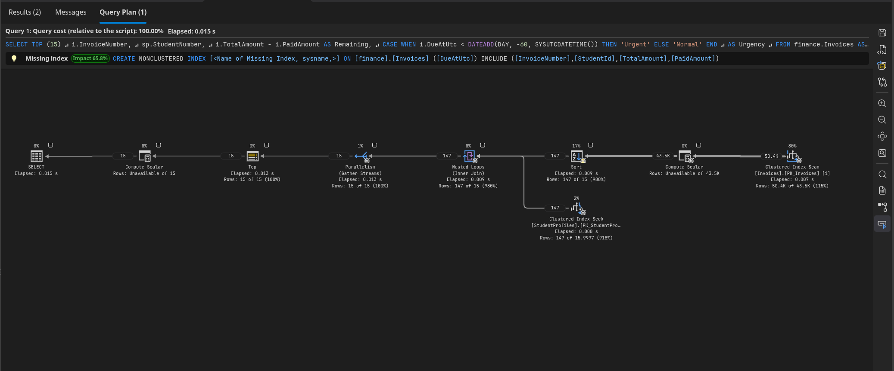

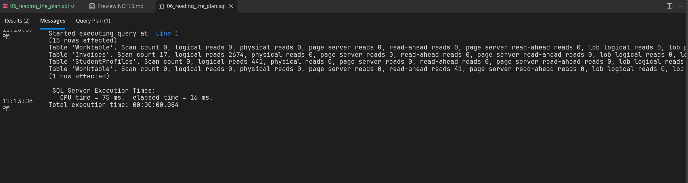

#### Explaining Every Number in `STATISTICS IO` & `STATISTICS TIME`
- **`Table 'Invoices'. Scan count 17, logical reads 2674, physical reads 0, page server reads 0, read-ahead reads 0`:**
  - **`Scan count 17`:** 1 coordinator thread + 16 parallel worker threads (`DOP = 16`) scanning `PK_Invoices`.
  - **`logical reads 2674`:** SQL Server read 2,674 × 8 KB pages (~21.4 MB) from the buffer pool (RAM) to scan the entire `finance.Invoices` clustered index (146,800 rows).
  - **`physical reads 0` / `read-ahead reads 0`:** All pages were already cached in RAM, so no disk reads were needed.
- **`Table 'StudentProfiles'. Scan count 0, logical reads 441, physical reads 0, read-ahead reads 0`:**
  - **`Scan count 0`:** Every access was a unique point seek on `PK_StudentProfiles` (no range scans).
  - **`logical reads 441`:** 147 unique Clustered Index Seeks × 3 B-tree levels (root → intermediate → leaf) = **441 pages**.
- **`Table 'Worktable'. Scan count 0, logical reads 0, ..., read-ahead reads 41`:**
  - Internal `tempdb` worktable activity caused by the parallel `Sort` operator spilling to `tempdb` (confirmed by the spill warning in `Sort`'s properties).
- **`SQL Server Execution Times: CPU time = 75 ms, elapsed time = 16 ms`:**
  - **`CPU time = 75 ms`:** Total CPU work summed across all parallel threads.
  - **`elapsed time = 16 ms`:** Actual wall-clock time the query took (`0.015 s` in the plan). CPU time is ~4.7× higher than elapsed time because the work ran in parallel across multiple CPU cores.
  - **`Total execution time: 00:00:00.084`:** Client-side end-to-end time including rendering/network overhead.
- **Missing Index Banner (`Impact 65.8%`):**
  - SQL Server suggests `CREATE NONCLUSTERED INDEX ... ON [finance].[Invoices] ([DueAtUtc]) INCLUDE ([InvoiceNumber], [StudentId], [TotalAmount], [PaidAmount])` to turn the full Clustered Index Scan (80% of plan cost) into an Index Seek on `DueAtUtc`.

---

### 3. Operator-by-Operator Breakdown (Right → Left)

#### Node 7 — Clustered Index Scan (`[Invoices].[PK_Invoices] [i]`)
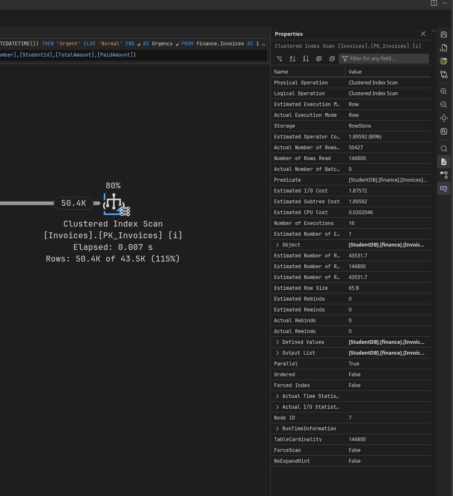

- **What it does & why SQL Server chose it:** Reads every leaf page of `finance.Invoices` and applies the residual `WHERE` predicate (`PaidAmount < TotalAmount AND DueAtUtc < SYSUTCDATETIME()`). Chosen because no existing index leads with `DueAtUtc` or covers all needed columns (`InvoiceNumber`, `StudentId`, `TotalAmount`, `PaidAmount`, `DueAtUtc`).
- **Properties explained:**
  - `Physical / Logical Operation`: `Clustered Index Scan` — full leaf-level scan of the clustered PK.
  - `Estimated / Actual Execution Mode`: `Row` — processes one row at a time (RowStore).
  - `Storage`: `RowStore` — standard row-oriented B-tree pages.
  - `Estimated Operator Cost`: `1.89592 (80%)` (`Estimated I/O Cost = 1.87572`, `Estimated CPU Cost = 0.0202046`, `Estimated Subtree Cost = 1.89592`) — dominates query cost because of full-table I/O.
  - `Actual Number of Rows`: `50,427` vs `Estimated Number of Rows`: `43,531.7` (115% — slightly underestimated).
  - `Number of Rows Read` / `TableCardinality`: `146,800` — all rows in the table were inspected to find the 50,427 matching rows.
  - `Actual Number of Batches`: `0` (Row mode, not Batch mode).
  - `Predicate`: Residual filter evaluated row-by-row on `PaidAmount < TotalAmount AND DueAtUtc < SYSUTCDATETIME()`.
  - `Number of Executions`: `16` (16 parallel worker threads; `Estimated Number of Executions = 1`).
  - `Estimated Row Size`: `65 B` — average width of columns passed upstream.
  - `Estimated / Actual Rebinds & Rewinds`: `0` (single parallel scan, not re-executed per outer row).
  - `Parallel`: `True` | `Ordered`: `False` (scan order is irrelevant here) | `Forced Index / ForceScan / NoExpandHint`: `False` (no query hints used).

---

#### Node 6 — Compute Scalar (Right, Before Sort)
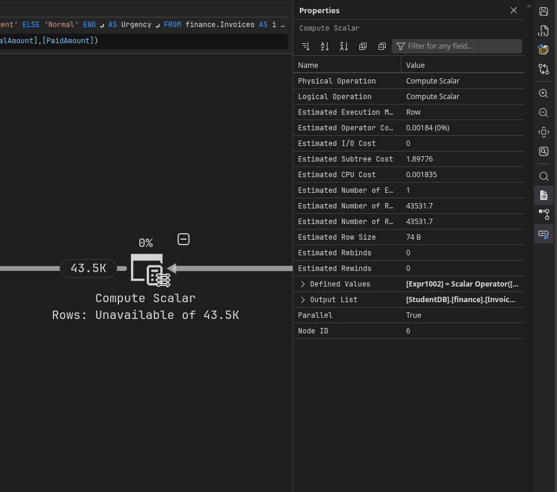

- **What it does & why SQL Server chose it:** Computes `Expr1002 = i.TotalAmount - i.PaidAmount` (`Remaining`) **before** the `Sort` operator because `Sort` needs `Remaining` to order rows descending.
- **Properties explained:**
  - `Physical / Logical Operation`: `Compute Scalar` | `Execution Mode`: `Row` | `Parallel`: `True`.
  - `Estimated Operator Cost`: `0.00184 (0%)` (`I/O = 0`, `CPU = 0.001835`, `Subtree Cost = 1.89776`).
  - `Estimated Number of Rows`: `43,531.7` | `Estimated Row Size`: `74 B` (grew from 65 B after adding `Remaining`).
  - `Defined Values`: `[Expr1002] = Scalar Operator(TotalAmount - PaidAmount)`.
  - `Rebinds / Rewinds`: `0` | `Node ID`: `6`.

---

#### Node 5 — Sort (`Expr1002 Descending`)
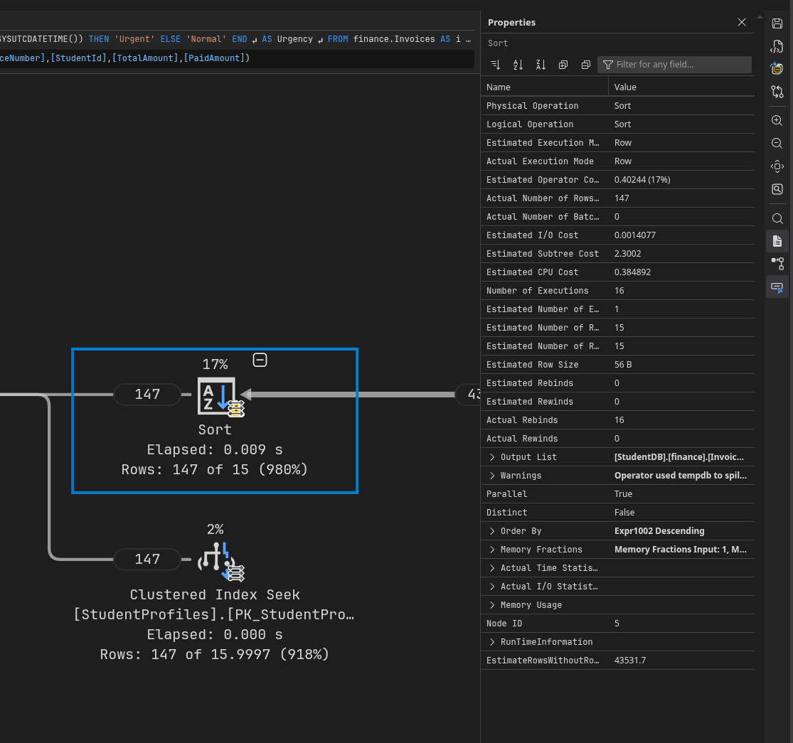

- **What it does & why SQL Server chose it:** Sorts each parallel thread's rows by `Remaining DESC` (`Expr1002 Descending`) **before** the join so SQL Server only joins the highest-remaining rows instead of all 50,427 rows. Note this is a full `Sort` (not `Top N Sort`) because the `Nested Loops` join sits between `Sort` and `Top (15)`.
- **Properties explained:**
  - `Physical / Logical Operation`: `Sort` | `Execution Mode`: `Row` | `Parallel`: `True` | `Distinct`: `False`.
  - `Estimated Operator Cost`: `0.40244 (17%)` (`I/O = 0.0014077`, `CPU = 0.384892`, `Subtree Cost = 2.3002`).
  - `Actual Number of Rows`: `147` vs `Estimated Number of Rows`: `15` (980% — `EstimateRowsWithoutRowGoal = 43,531.7`). Each of the 16 parallel threads emitted rows until the global `Top (15)` closed the pipeline, totaling 147 rows.
  - `Number of Executions`: `16` | `Actual Rebinds`: `16` (1 per parallel thread) | `Actual Rewinds`: `0`.
  - `Estimated Row Size`: `56 B` (dropped `TotalAmount` and `PaidAmount` since `Remaining` is already computed).
  - `Order By`: `Expr1002 Descending`.
  - `Warnings`: **`Operator used tempdb to spill...`** — the sort spilled to `tempdb` because the 16 MB memory grant was split across 16 parallel threads and actual input rows (`50,427`) exceeded the estimate (`43,531.7`).
  - `Memory Fractions`: `Input: 1, Output: 1` (the Sort uses 100% of the query's memory grant).

---

#### Node 8 — Clustered Index Seek (`[StudentProfiles].[PK_StudentProfiles] [sp]`)
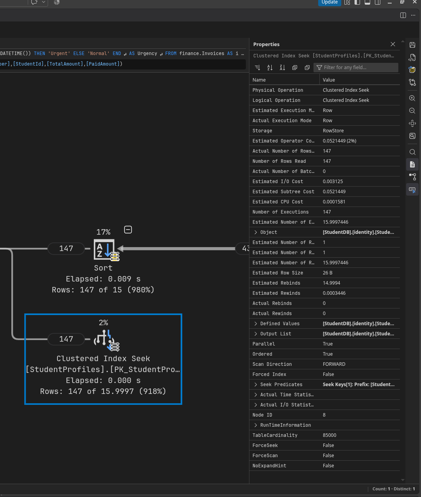

- **What it does & why SQL Server chose it:** Performs a unique B-tree lookup on `PK_StudentProfiles (Id)` for each `i.StudentId` passed from the outer side of `Nested Loops` to fetch `sp.StudentNumber`. Chosen because `sp.Id` is the clustered primary key and only ~15–147 rows need lookup.
- **Properties explained:**
  - `Physical / Logical Operation`: `Clustered Index Seek` | `Execution Mode`: `Row` | `Storage`: `RowStore`.
  - `Estimated Operator Cost`: `0.0521449 (2%)` (`I/O = 0.003125`, `CPU = 0.0001581`, `Subtree Cost = 0.0521449`).
  - `Actual Number of Rows` / `Number of Rows Read`: `147` (1 exact row per seek).
  - `Number of Executions`: `147` vs `Estimated Number of Executions`: `15.9997446` (918%).
  - `Estimated Rows Per Execution`: `1` | `Estimated Row Size`: `26 B` | `TableCardinality`: `85,000`.
  - `Estimated Rebinds`: `14.9994`, `Estimated Rewinds`: `0.0003446` (reflecting distinct `StudentId` values expected across ~16 outer rows).
  - `Parallel`: `True` | `Ordered`: `True` | `Scan Direction`: `FORWARD` | `Seek Predicates`: `Prefix: [StudentProfiles].Id = [Invoices].StudentId`.
  - `Forced Index / ForceSeek / ForceScan / NoExpandHint`: `False`.

---

#### Node 3 — Nested Loops (`Inner Join`)
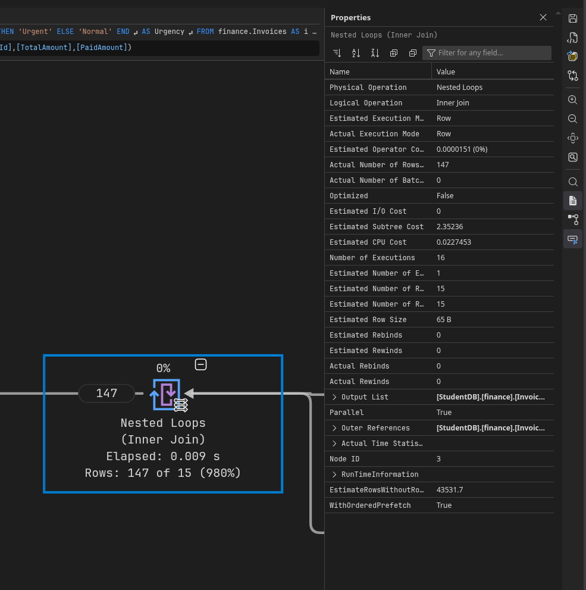

- **What it does & why SQL Server chose it:** For every row from the sorted `Invoices` outer input, drives a Clustered Index Seek on `StudentProfiles` using `Outer References = i.StudentId`. Chosen because the `TOP (15)` row goal made the optimizer expect very few outer rows (~15), where Nested Loops + PK Seek is far cheaper than Hash Match or Merge Join.
- **Properties explained:**
  - `Physical Operation`: `Nested Loops` | `Logical Operation`: `Inner Join` | `Execution Mode`: `Row` | `Parallel`: `True`.
  - `Estimated Operator Cost`: `0.0000151 (0%)` (`I/O = 0`, `CPU = 0.0227453`, `Subtree Cost = 2.35236`).
  - `Actual Number of Rows`: `147` vs `Estimated`: `15` (`EstimateRowsWithoutRowGoal = 43,531.7`) | `Number of Executions`: `16`.
  - `Estimated Row Size`: `65 B` | `Optimized`: `False` | `WithOrderedPrefetch`: `True` (asynchronously prefetches inner pages in order to hide I/O latency).
  - `Outer References`: `[Invoices].[StudentId]`.

---

#### Node 2 — Parallelism (`Gather Streams`)
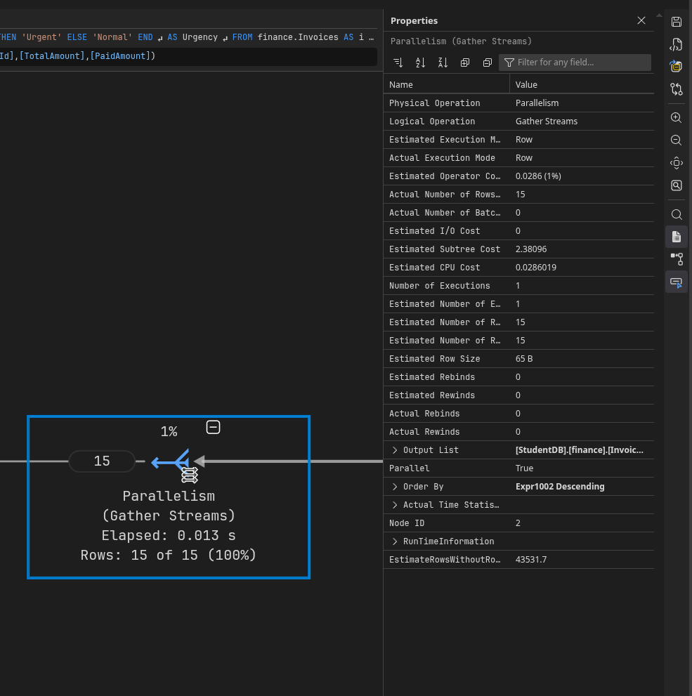

- **What it does & why SQL Server chose it:** Merges the 16 parallel worker streams back into a single serial stream while **preserving sort order** (`Order By: Expr1002 Descending`) so the serial `Top (15)` operator receives rows in global descending order of `Remaining`.
- **Properties explained:**
  - `Physical Operation`: `Parallelism` | `Logical Operation`: `Gather Streams` | `Execution Mode`: `Row` | `Parallel`: `True`.
  - `Estimated Operator Cost`: `0.0286 (1%)` (`I/O = 0`, `CPU = 0.0286019`, `Subtree Cost = 2.38096`).
  - `Actual Number of Rows`: `15` vs `Estimated`: `15` (100% — stopped pulling as soon as `Top` got 15 rows; `EstimateRowsWithoutRowGoal = 43,531.7`).
  - `Number of Executions`: `1` | `Estimated Row Size`: `65 B` | `Order By`: `Expr1002 Descending`.

---

#### Node 1 — Top
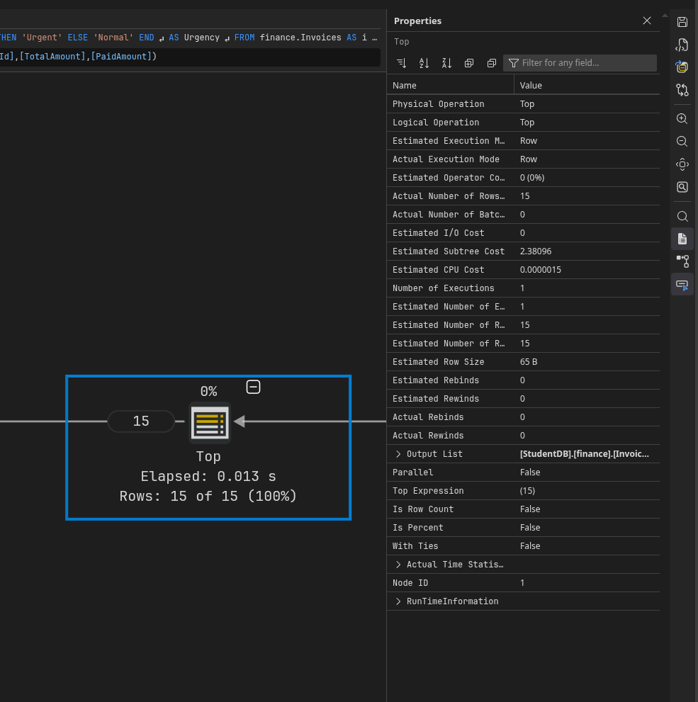

- **What it does & why SQL Server chose it:** Enforces `TOP (15)` on the single merged sorted stream from `Gather Streams` and stops execution once 15 rows are emitted.
- **Properties explained:**
  - `Physical / Logical Operation`: `Top` | `Execution Mode`: `Row` | `Parallel`: `False` (serial).
  - `Estimated Operator Cost`: `0 (0%)` (`I/O = 0`, `CPU = 0.0000015`, `Subtree Cost = 2.38096`).
  - `Actual Number of Rows`: `15` vs `Estimated`: `15` (100%) | `Number of Executions`: `1` | `Estimated Row Size`: `65 B`.
  - `Top Expression`: `(15)` | `Is Row Count`: `False` | `Is Percent`: `False` | `With Ties`: `False`.

---

#### Node 0 — Compute Scalar (Left, After Top)
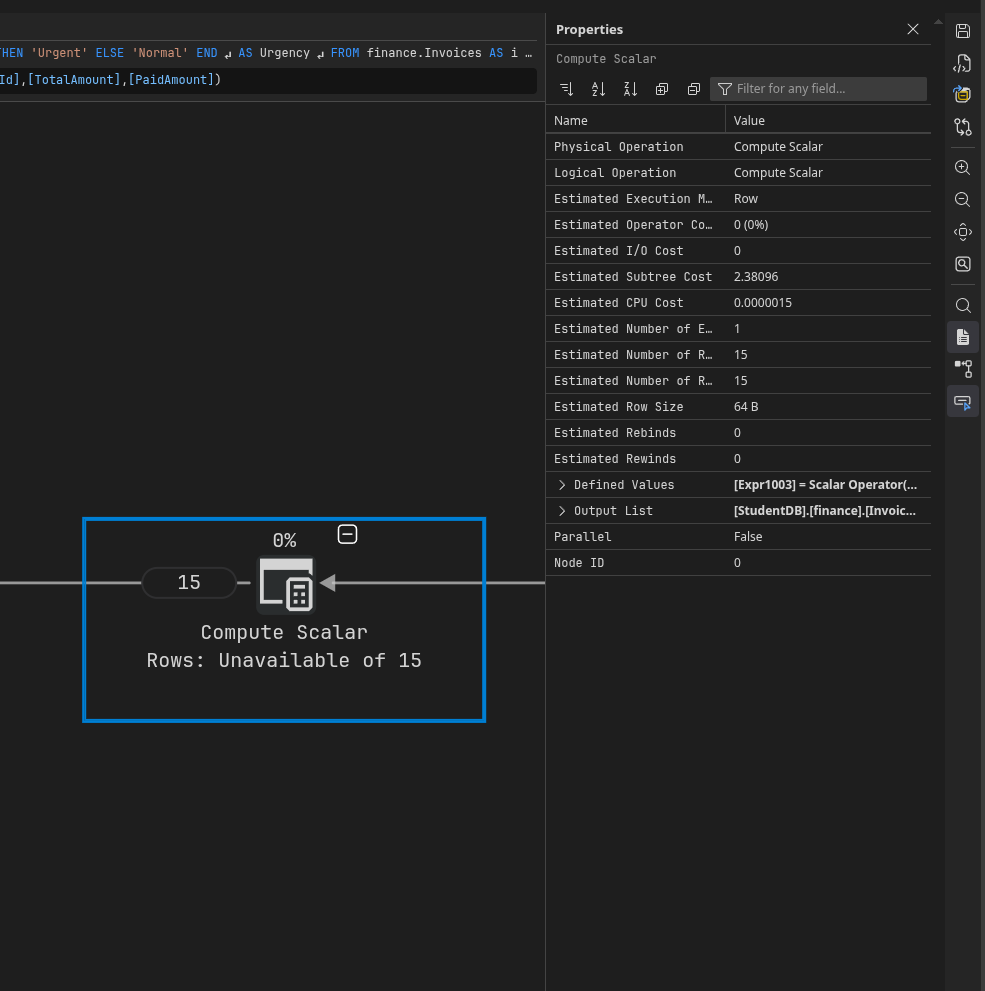

- **What it does & why SQL Server chose it:** Evaluates `Expr1003 = CASE WHEN i.DueAtUtc < DATEADD(DAY, -60, SYSUTCDATETIME()) THEN 'Urgent' ELSE 'Normal' END` (`Urgency`). SQL Server smartly deferred this until **after** `Top (15)` so it runs only 15 times instead of 50,427 times!
- **Properties explained:**
  - `Physical / Logical Operation`: `Compute Scalar` | `Execution Mode`: `Row` | `Parallel`: `False`.
  - `Estimated Operator Cost`: `0 (0%)` (`I/O = 0`, `CPU = 0.0000015`, `Subtree Cost = 2.38096`).
  - `Estimated Number of Rows`: `15` | `Estimated Row Size`: `64 B`.
  - `Defined Values`: `[Expr1003] = Scalar Operator(CASE WHEN ...)`.

---

#### Root — SELECT
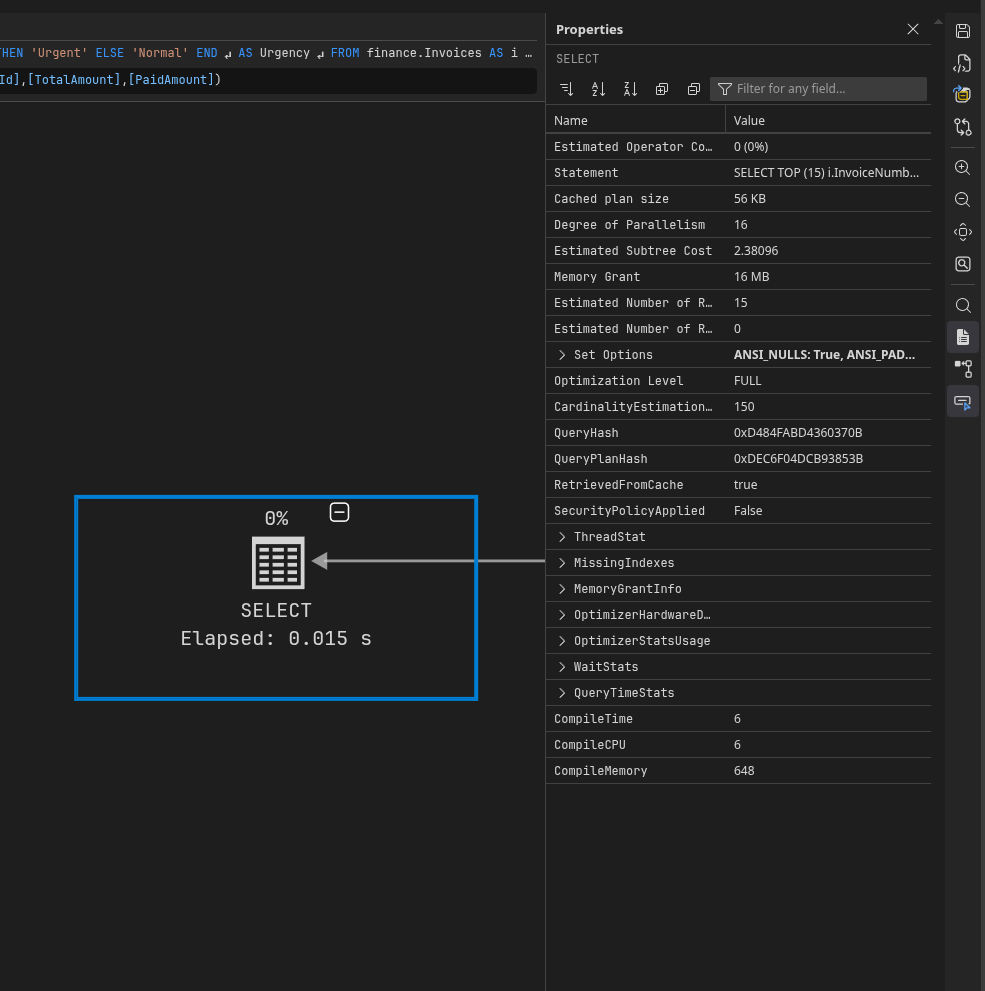

- **What it does:** Root statement operator returning the final 15 rows to the client and holding plan-level metadata.
- **Properties explained:**
  - `Estimated Operator Cost`: `0 (0%)` | `Estimated Subtree Cost`: `2.38096` | `Estimated Number of Rows`: `15`.
  - `Cached plan size`: `56 KB` | `RetrievedFromCache`: `true` (plan was reused from cache).
  - `Degree of Parallelism`: `16` — executed across 16 parallel threads.
  - `Memory Grant`: `16 MB` — RAM reserved for the parallel `Sort`.
  - `Optimization Level`: `FULL` — full cost-based optimization was performed.
  - `CardinalityEstimationModelVersion`: `150` (SQL Server 2019 CE).
  - `QueryHash`: `0xD484FABD4360370B` | `QueryPlanHash`: `0xDEC6F04DCB93853B` — fingerprints identifying query text and plan shape.
  - `SecurityPolicyApplied`: `False` (no Row-Level Security).
  - `CompileTime`: `6 ms` | `CompileCPU`: `6 ms` | `CompileMemory`: `648 KB` — cost of initial compilation.
  - `Set Options`: Standard ANSI session settings (`ANSI_NULLS: True`, `ANSI_PADDING: True`, etc.).

---

### 4. Where My Prediction Was Right vs. Wrong

- **Right:**
  - `Clustered Index Seek` on `identity.StudentProfiles`
  - `Nested Loops (Inner Join)`
  - `Compute Scalar` (actually **two** — one before `Sort` for `Remaining`, and a second after `Top` for `Urgency`)
  - Parallel execution (`Parallelism (Gather Streams)` with `DOP = 16`)
- **Wrong:**
  1. **`finance.Invoices` access:** I predicted an *Index Seek + Nonclustered Index Scan*, but SQL Server chose a **Clustered Index Scan** (`PK_Invoices`, 80% cost) because no nonclustered index leads with `DueAtUtc` or covers `InvoiceNumber`, `StudentId`, `TotalAmount`, `PaidAmount`, and `DueAtUtc`.
  2. **`Top N Sort` vs `Sort` + `Top`:** I predicted a combined **Top N Sort**, but SQL Server actually used a **full parallel `Sort`** (which even spilled to `tempdb`!) before the `Nested Loops` join, followed by an order-preserving `Parallelism (Gather Streams)` and a separate serial **`Top (15)`** operator.

---

## Task 7 — Make It Faster

All 8 queries suffer from **non-SARGable** predicates (or generic plan caching in `7.7`), preventing SQL Server from performing an **Index Seek** on the production indexes and forcing an **Index Scan** or **Clustered Index Scan**.

### 7.1 — Users registered in March 2026
- **Problem:** Wrapping `CreatedAtUtc` in `YEAR()` and `MONTH()` makes the predicate non-SARGable, forcing a full **Index Scan** on `IX_Users_CreatedAtUtc` (98.47% relative cost, 0.009 s, 1,054 rows).
- **Fix:** Rewrite as a half-open range (`CreatedAtUtc >= '2026-03-01' AND CreatedAtUtc < '2026-04-01'`), enabling an **Index Seek** on `IX_Users_CreatedAtUtc` (1.53% relative cost, 0.000 s, 1,054 rows).
- **Logical Reads:** Before = **1,012** (CPU 9 ms) | After = **15** (CPU 1 ms) — **~67× fewer reads**
- 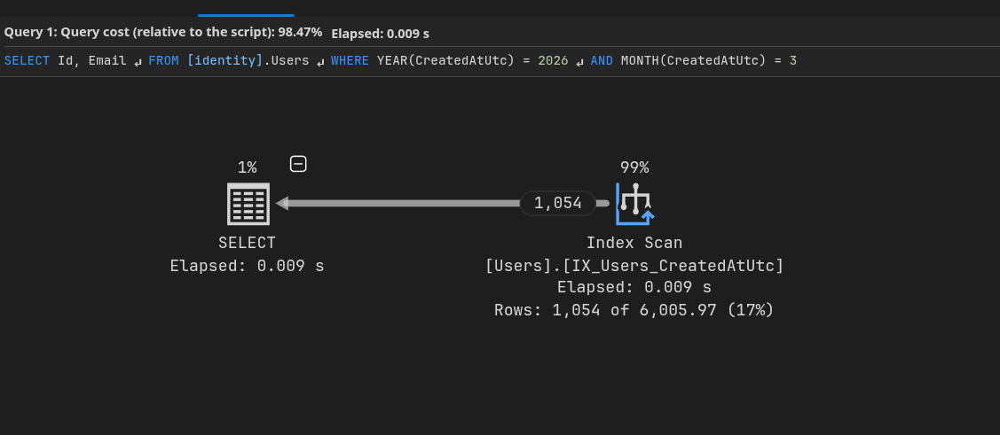
- 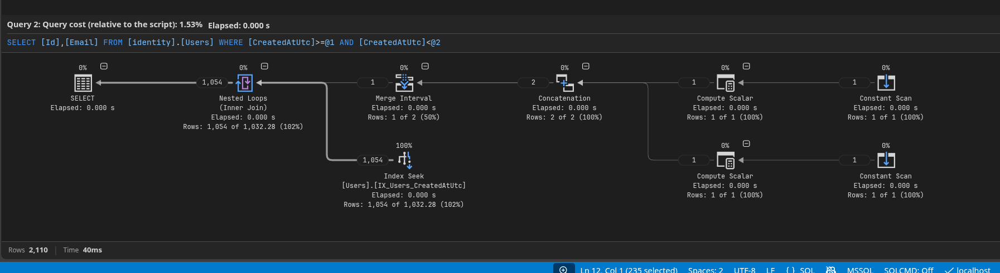

### 7.2 — Payments of the last 30 days
- **Problem:** Wrapping `PaidAtUtc` inside `DATEDIFF(DAY, PaidAtUtc, SYSUTCDATETIME()) <= 30` prevents seeking `IX_Payments_PaidAtUtc`, causing an **Index Scan** (88.90% relative cost, 0.013 s, 15,548 rows).
- **Fix:** Keep `PaidAtUtc` isolated on the left side (`PaidAtUtc >= CAST(DATEADD(DAY, -30, CAST(SYSUTCDATETIME() AS DATE)) AS DATETIME2)`), turning the scan into an **Index Seek** (11.10% relative cost, 0.003 s, 15,548 rows).
- **Logical Reads:** Before = **612** (CPU 13 ms) | After = **78** (CPU 3 ms) — **~7.8× fewer reads**
- 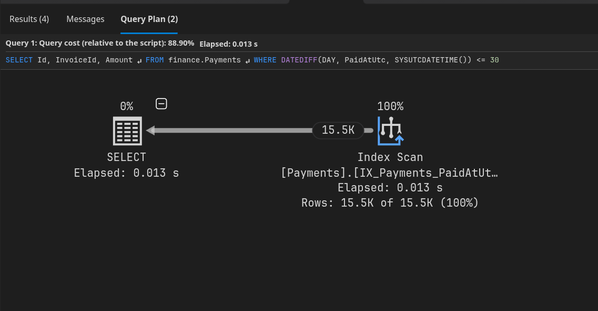
- 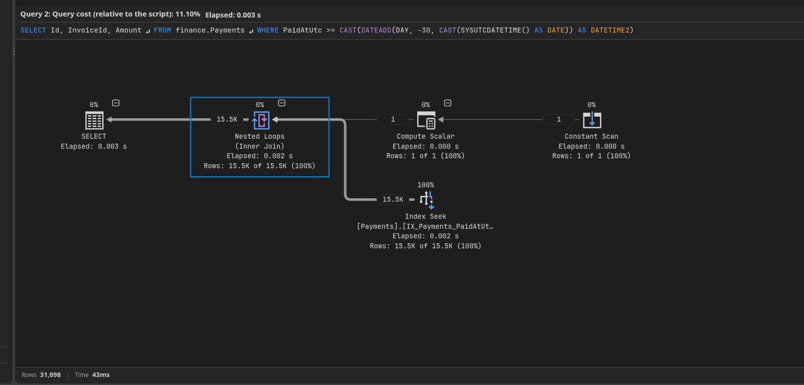

### 7.3 — Last names starting with `"Abd"`
- **Problem:** `LEFT(LastName, 3) = N'Abd'` applies a function to the indexed column, causing a full **Index Scan** on `IX_Users_Email` (98.76% relative cost, 0.007 s, 839 rows).
- **Fix:** Use a prefix pattern `LastName LIKE N'Abd%'`, which is SARGable and performs a covering **Index Seek** on `IX_Users_LastName` (1.24% relative cost, 0.000 s, 839 rows).
- **Logical Reads:** Before = **1,283** (CPU 7 ms) | After = **20** (CPU 1 ms) — **~64× fewer reads**
- 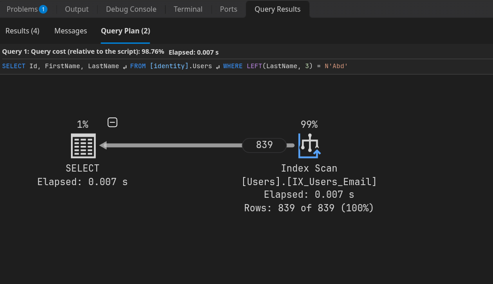
- 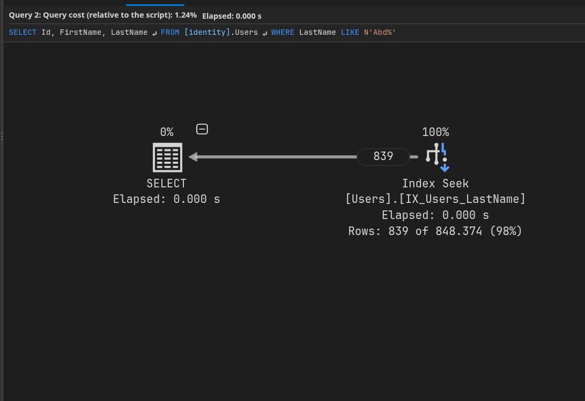

### 7.4 — `operations.AuditLogs` arithmetic on PK
- **Problem:** `Id + 1 = 50001` performs arithmetic on the clustered primary key `Id`, preventing a PK seek and forcing a parallel full **Index Scan** on `IX_AuditLogs_Actor` across 12M+ rows plus a `Key Lookup` on `PK_AuditLogs` (100.00% relative cost, 0.079 s, 1 row).
- **Fix:** Move the math to the constant (`Id = 50000`), resulting in a single **Clustered Index Seek** on `PK_AuditLogs` (0.00% relative cost, 0.000 s, 1 row).
- **Logical Reads:** Before = **130,925** (CPU 1,207 ms, elapsed 174 ms) | After = **4** (CPU 0 ms, elapsed 0 ms) — **~32,731× fewer reads**
- 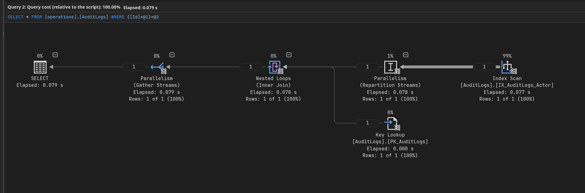
- 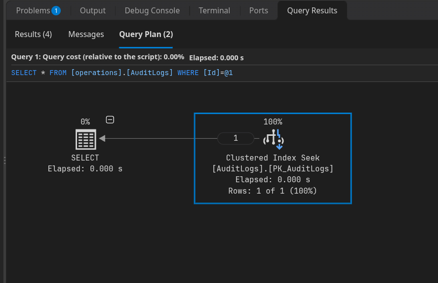

### 7.5 — Implicit conversion on `InvoiceNumber`
- **Problem:** `finance.Invoices.InvoiceNumber` is `VARCHAR(30)`, while `N'LAB-INV-2026-000001'` is `NVARCHAR`. Because `NVARCHAR` has higher type precedence, SQL Server wraps the column in `CONVERT_IMPLICIT(nvarchar(30), InvoiceNumber)` (showing the yellow warning icon on `SELECT`), forcing an **Index Scan** on `IX_Invoices_Number` + `Key Lookup` (99.18% relative cost, 0.012 s, 1 row).
- **Fix:** Drop the `N` prefix (`'LAB-INV-2026-000001'`) so both sides are `VARCHAR`, eliminating the `CONVERT_IMPLICIT` warning and enabling an **Index Seek** on `IX_Invoices_Number` + `Key Lookup` (0.82% relative cost, 0.000 s, 1 row).
- **Logical Reads:** Before = **747** (CPU 13 ms) | After = **6** (CPU 0 ms) — **~124.5× fewer reads**
- 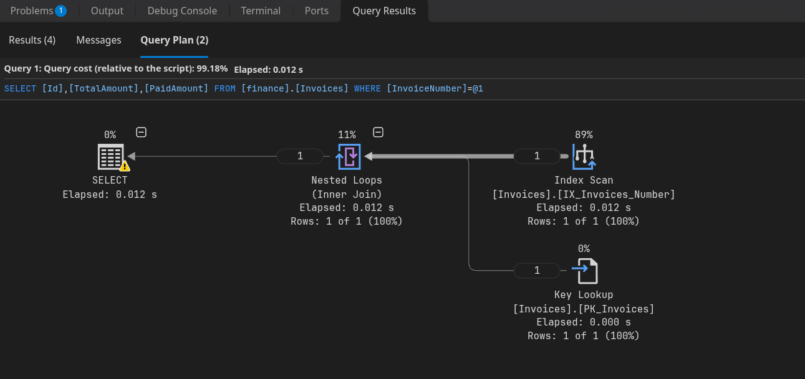
- 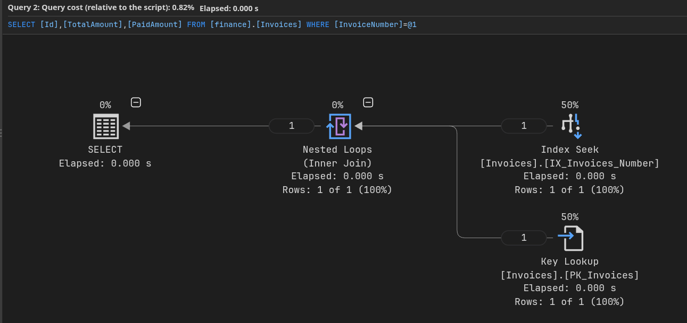

### 7.6 — Unnecessary `UPPER()` under case-insensitive collation
- **Problem:** The database collation is `SQL_Latin1_General_CP1_CI_AS` (`CI` = Case Insensitive), so `UPPER(Email)` is unnecessary and non-SARGable, forcing an **Index Scan** on `IX_Users_CreatedAtUtc` + `Key Lookup` on `PK_Users` (99.27% relative cost, 0.009 s, 1 row).
- **Fix:** Compare directly (`Email = @Email`), enabling a covering **Index Seek** on `IX_Users_Email` with no Key Lookup (0.36% relative cost, 0.000 s, 1 row).
- **Logical Reads:** Before = **1,015** (CPU 12 ms) | After = **3** (CPU 0 ms) — **~338× fewer reads**
- 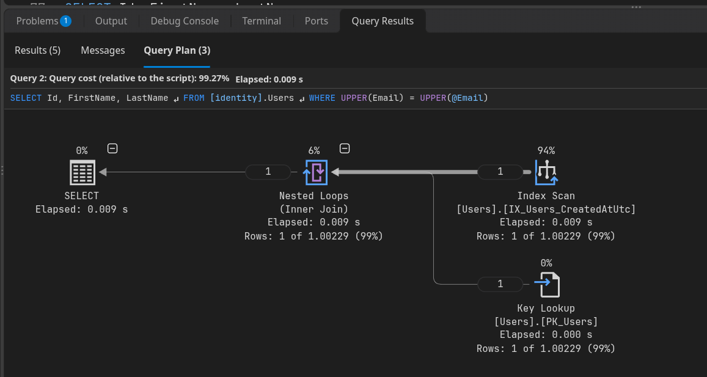
- 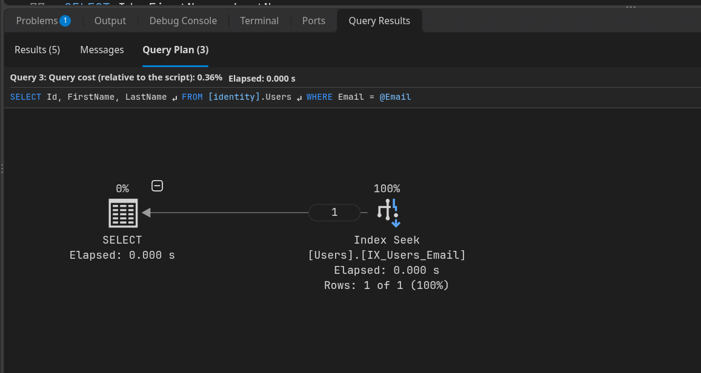

### 7.7 — Catch-all optional search filter (`@LastName IS NULL OR LastName = @LastName`)
- **Problem:** SQL Server must compile one reusable cached plan that works even if `@LastName` is `NULL`, so it cannot seek and instead performs an **Index Scan** on `IX_Users_Email` (98.79% relative cost, 0.009 s, 839 rows).
- **Fix:** Add `OPTION (RECOMPILE)` so SQL Server inspects the runtime value (`N'Hassan'`), simplifies the predicate, and builds a covering **Index Seek** on `IX_Users_LastName` (1.21% relative cost, 0.000 s, 839 rows).
- **Logical Reads:** Before = **1,283** (CPU 8 ms) | After = **18** (CPU 1 ms) — **~71× fewer reads**
- 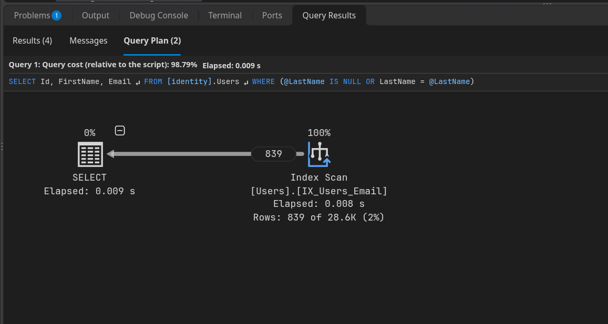
- 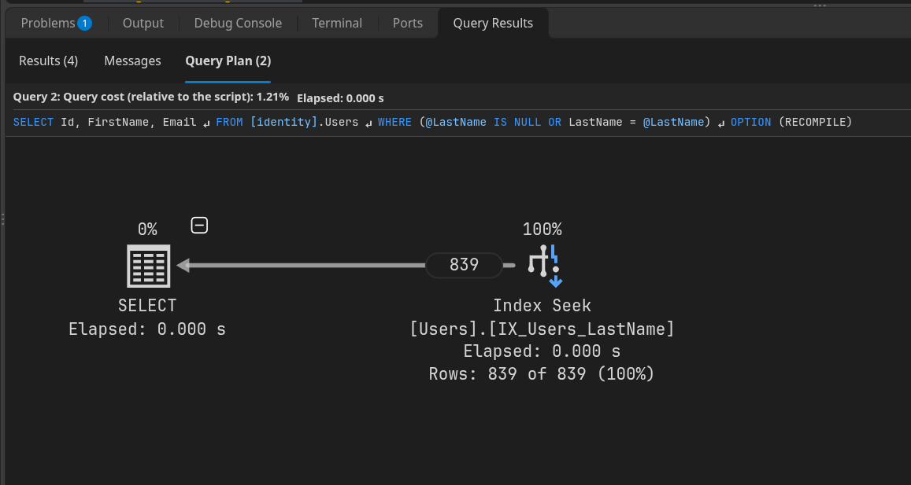

### 7.8 — Custom example: wrapping a nullable column in `ISNULL()`
- **Problem:** `WHERE ISNULL(PaidAtUtc, '1900-01-01') >= '2026-10-01' AND ISNULL(PaidAtUtc, '1900-01-01') < '2026-11-01'` wraps the nullable indexed column `PaidAtUtc` in `ISNULL()`, making it non-SARGable and forcing an **Index Scan** on `IX_Payments_PaidAtUtc` (89.82% relative cost, 0.010 s, 14,087 rows).
- **Fix:** Remove `ISNULL()` (`WHERE PaidAtUtc >= '2026-10-01' AND PaidAtUtc < '2026-11-01'`). Range comparisons already exclude `NULL`s, so it returns identical rows via an **Index Seek** on `IX_Payments_PaidAtUtc` (10.18% relative cost, 0.003 s, 14,087 rows).
- **Logical Reads:** Before = **612** (CPU 16 ms) | After = **71** (CPU 5 ms) — **~8.6× fewer reads**
- 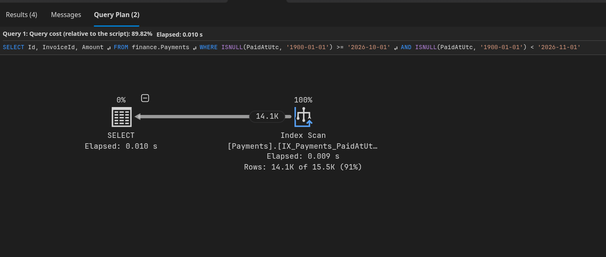
- 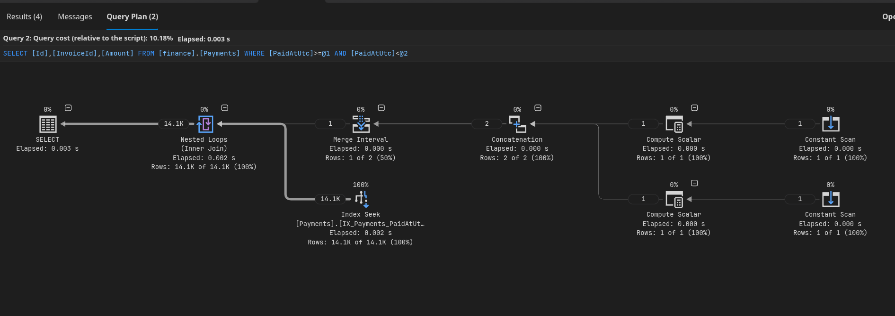

---

## Task 8 — When the Estimate Is Wrong

### 1. Before Fix — Sort Spill Warning
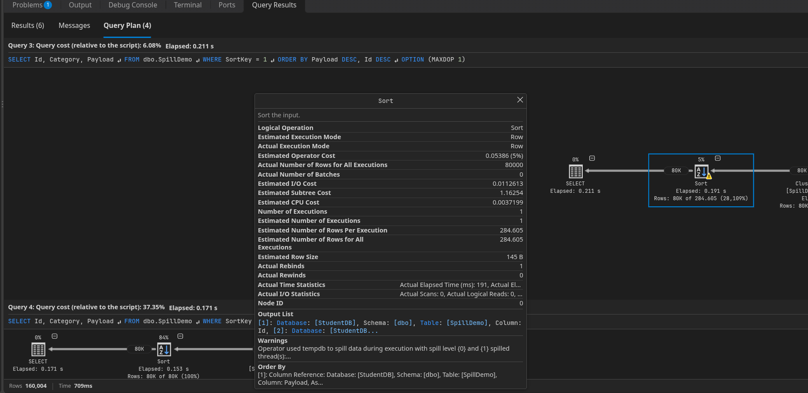

- **What happened:** The `Sort` operator displays a yellow warning triangle (`Operator used tempdb to spill data during execution`). SQL Server estimated only **~81 rows** (`0.1%` selectivity) and granted the minimum memory (~1 MB), but **80,001 rows** actually arrived at runtime.
- **Why it happened (Root Cause):** Statistics on `dbo.SpillDemo (SortKey)` were **stale** (`NORECOMPUTE` froze the histogram when only 1 out of 1,000 rows had `SortKey = 1`, before 80,000 more `SortKey = 1` rows were loaded). Because SQL Server computes memory grants *before* execution using estimated row count × estimated row size, a severe underestimate produces a tiny memory grant that overflows at runtime.
- **What the spill level means:**
  - **Spill Level 1:** Data did not fit in the memory grant, so SQL Server wrote sorted runs out to `tempdb` and merged them in a single pass.
  - **Spill Level 2 (or higher):** Even the merge pass could not fit in memory, forcing **multiple** read/write passes over `tempdb` — significantly slower than Level 1.
- **Why a `tempdb` spill is slow:**
  - RAM access is nanoseconds; `tempdb` resides on storage and incurs disk I/O latency, extra `Worktable` writes and reads, `tempdb` allocation page contention (`PFS`/`GAM`/`SGAM`), and extra CPU to serialize/deserialize and merge runs.

### 2. After Fix — Updated Statistics (Warning Gone)

- **Fix:** Ran `UPDATE STATISTICS dbo.SpillDemo WITH FULLSCAN;` so the `SortKey` histogram reflects all **80,001** matching rows.
- **Result:** On re-execution, SQL Server accurately estimated 80,001 rows (100%), allocated a sufficient memory grant up front, completed the entire `Sort` in RAM, and the yellow spill warning disappeared completely.

---

## Task 9 — One of Each

### 1. `DISTINCT` on an Unindexed Column (`Category`)
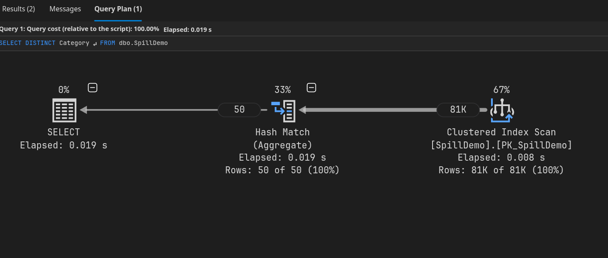

- **Operator SQL Server used:** **`Hash Match (Aggregate)`** (after a `Clustered Index Scan` on `dbo.SpillDemo`).
- **How `Hash Match (Aggregate)` works:** SQL Server scans all rows of `dbo.SpillDemo`, computes a hash of each `Category` value, and inserts it into an in-memory hash table. If the value already exists in the bucket, it is discarded as a duplicate; otherwise it is added. Once the scan completes, SQL Server outputs one row per unique entry. Because it builds a hash table in RAM, it requires a **memory grant** (and can spill to `tempdb` if there are far more distinct values than estimated).
- **The cheaper operator SQL Server did NOT use:** **`Stream Aggregate`**.
  - **How `Stream Aggregate` works:** It streams through rows one at a time, comparing each row only with the immediately preceding row. Whenever the value changes, it emits the new distinct value. It requires **no memory grant** (O(1) memory) and is **non-blocking**.
  - **What the data would need for SQL Server to use it:** The input rows must arrive **already sorted** by `Category` — for example, by creating a nonclustered index on `dbo.SpillDemo (Category)`. Without that index, the rows are unordered on `Category`, so SQL Server avoids sorting 81,000 rows and chooses `Hash Match (Aggregate)` instead.

### 2. `DISTINCT` on an Already-Unique Column (`Id`)
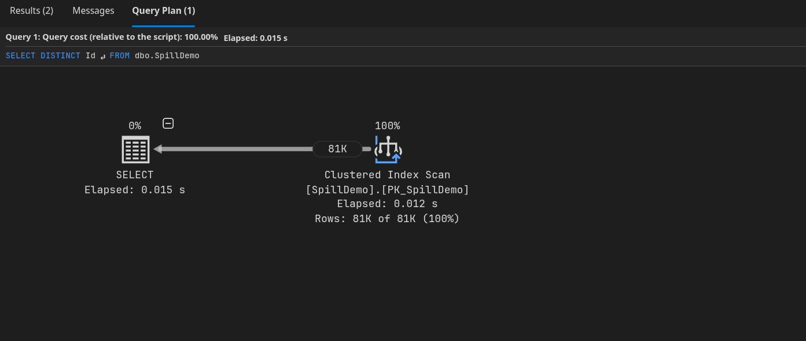

- **Plan produced:** A plain **`Clustered Index Scan`** on `PK_SpillDemo` directly into **`SELECT`** — with **no `Hash Match`, no `Stream Aggregate`, and no `Sort`**!
- **Why:** `Id` is the `PRIMARY KEY` of `dbo.SpillDemo`, so SQL Server's optimizer knows from schema metadata that every value is already guaranteed unique. During query simplification, the optimizer **completely eliminates the redundant `DISTINCT` operation** at zero runtime cost.

---

## Task 10 — The CTO's Question

_TODO: Compare integer/numeric IDs vs GUIDs (`UNIQUEIDENTIFIER`) with trade-offs._

---

## Task 11 — End of Semester Changes

_TODO: Brief notes on `11.1`–`11.5` (including `TRUNCATE TABLE` vs `DELETE`)._

---

## Task 12 — The Auditors Are Coming

_TODO: Brief notes on using `OUTPUT` (`DELETED` / `INSERTED`) for single-statement auditing and archiving._

---

## Task 13 — The Nightly Website Sync

_TODO: Brief notes on the single-statement `MERGE` sync and verification across all 3 runs._
